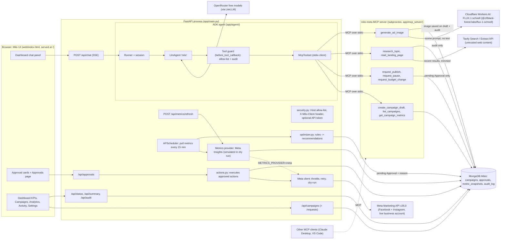
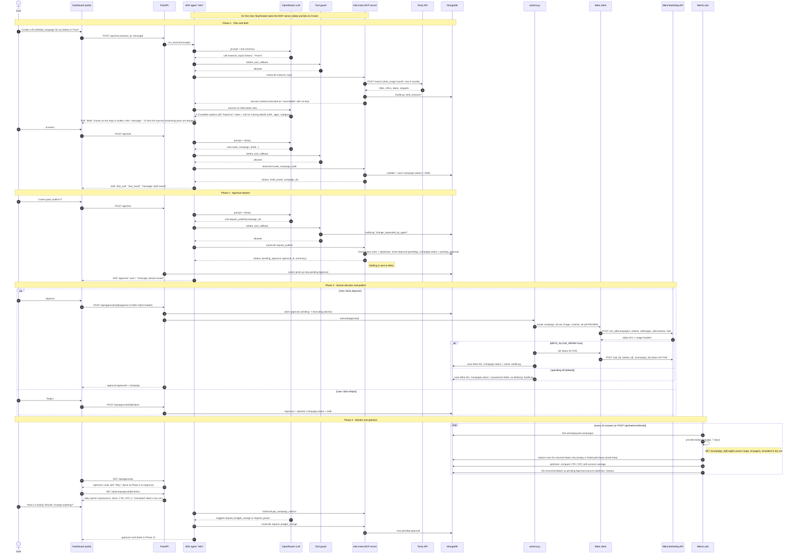
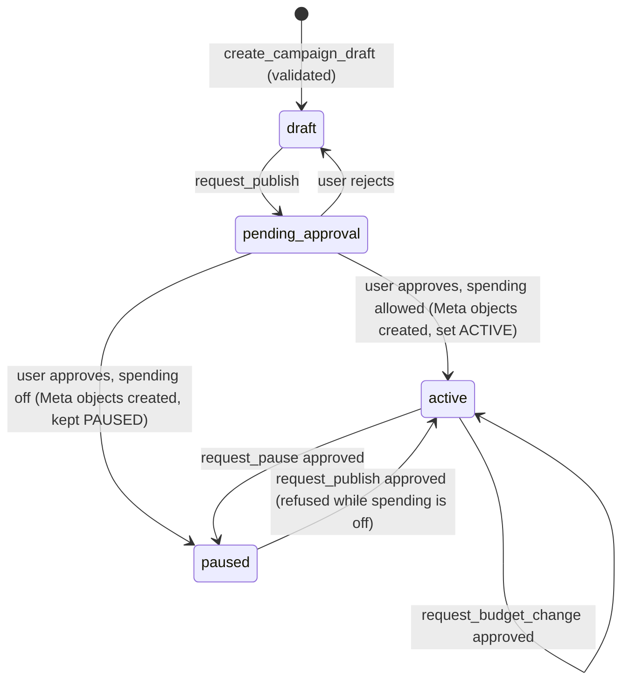
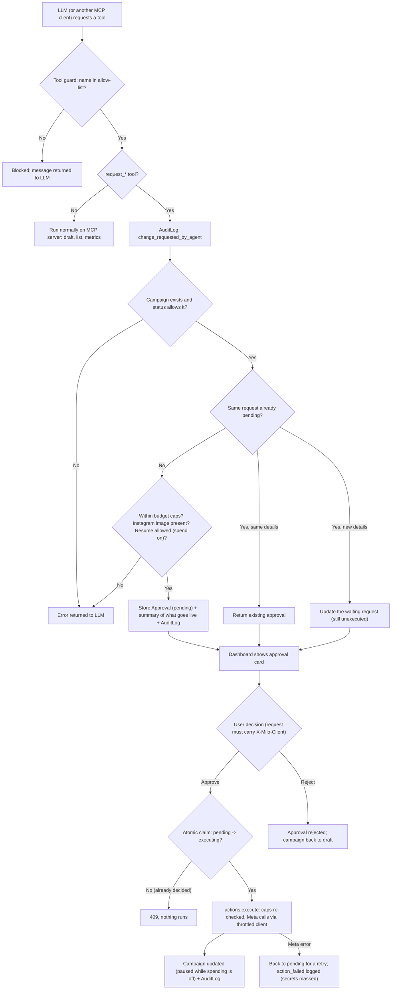
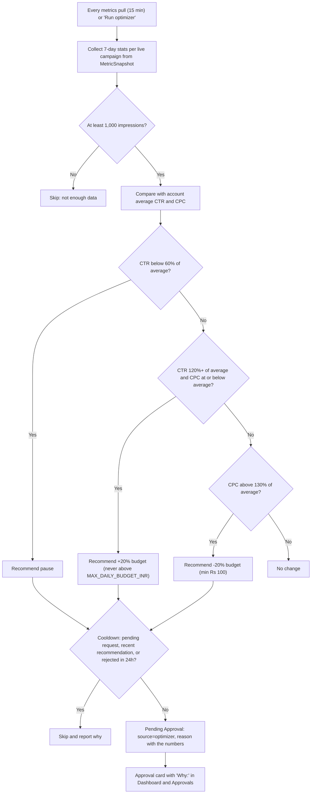
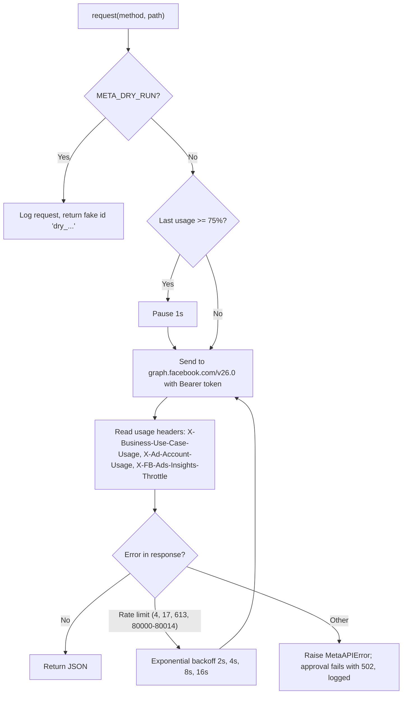
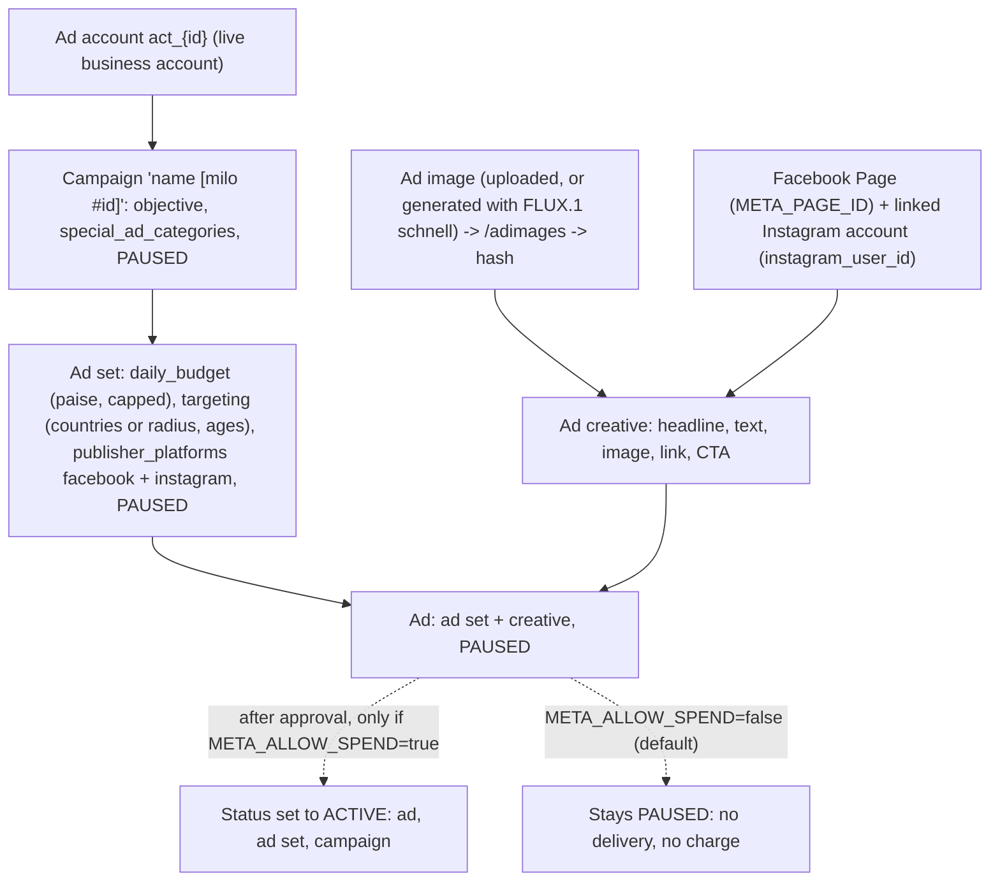
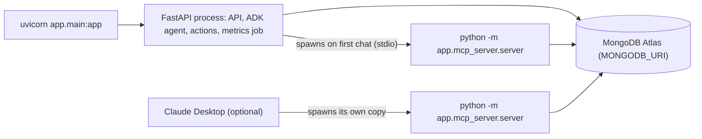
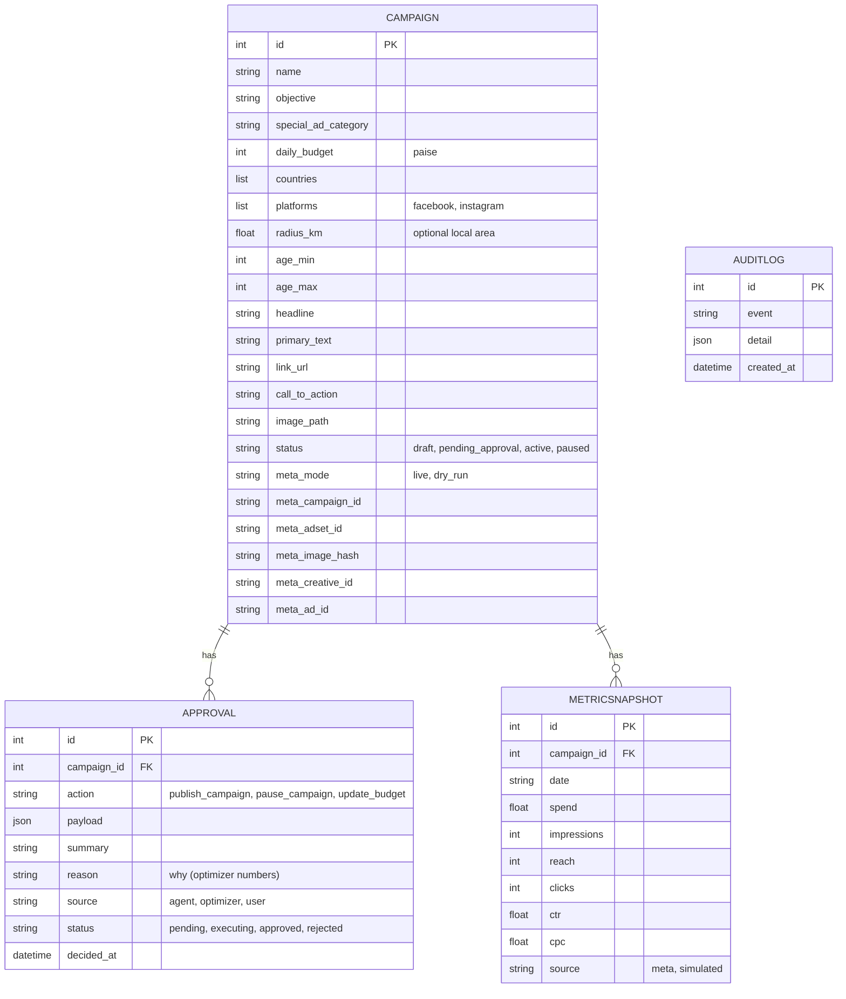

# Milo — Architecture

Milo is one FastAPI process plus one MCP server subprocess. The FastAPI app holds the **chat agent** (Google ADK),
the **approvals API**, the **Meta client** and a **metrics job**. The agent's tools live in the **milo-meta MCP
server**, which ADK starts over stdio. The same FastAPI process serves the UI (`web/`) at `/`, so the browser talks
only to its own origin; the backend talks to OpenRouter (LLM) and Meta (ads). Nothing that changes a live ad runs
without a human click.

> Diagrams use Mermaid. They render on GitHub, in VS Code (Markdown Preview Mermaid Support extension) and in most
> Markdown viewers.

## 1. System overview

**Key idea:** the LLM decides *what* to do, but code decides *whether* it happens. The MCP server is
**request-only**: its `request_*` tools store a pending Approval and never call Meta. Only `actions.py`, triggered by
the dashboard's Approve button, changes a live ad — whichever MCP client made the request.

## 2. Complete working flow: create → approve → publish → monitor

## 3. Campaign lifecycle

## 4. Approval gate logic

The gate has three layers: the **tool guard** in the agent, the **request-only MCP tools**, and the **human
decision** in the dashboard.

| Action | Allowed from status |
| --- | --- |
| `request_publish` | `draft`, `paused` (resume from `paused` only when spending is allowed or in dry run) |
| `request_pause` | `active` |
| `request_budget_change` | `active`, `paused` (new budget ≠ current, ≥ Rs 100, ≤ `MAX_DAILY_BUDGET_INR`; running total ≤ `MAX_TOTAL_DAILY_BUDGET_INR`) |

## 4b. Optimization loop

The rules live in `analyze()`, a pure function with no database access, so they are unit-tested directly. With only
one live campaign there is no average to compare against, so the loop only checks a CTR floor (0.6%). Reasons based
on simulated (dry-run) data say so.

## 5. Meta client: rate limits and safety

## 6. Meta object tree created on publish

## 7. Code map

| Path | Responsibility |
| --- | --- |
| `app/main.py` | FastAPI app, lifespan (DB init + scheduler), security middleware, serves `web/` |
| `app/security.py` | Host allow-list (DNS rebinding), `X-Milo-Client` header on changes (CSRF), optional `API_TOKEN` |
| `app/config.py` | Typed settings from `.env` |
| `app/mcp_server/server.py` | **milo-meta MCP server** (FastMCP, stdio): draft validation, list, metrics, `request_*` tools, `research_topic` + `read_landing_page` |
| `app/approvals.py` | Creates pending approvals: status rules, budget caps, Instagram image check, spend switch for resume, updates a waiting request with new details, audit |
| `app/creative/imagegen.py` | Ad image generation: FLUX.1 [schnell] on Cloudflare Workers AI (`@cf/black-forest-labs/flux-1-schnell`); adds "no text, no logos" to prompts, daily cap, saves the JPEG on the draft, audits `image_generated` |
| `app/research/tavily.py` | Tavily client: `search_recent()` (time-limited search, http(s) only, trimmed snippets) and `extract_page()` (https landing page, trimmed); `ResearchUnavailable` when off, no key or out of credits |
| `app/optimizer.py` | Rule-based optimization loop: `analyze()` (pure rules) + `run_optimizer()` (cooldowns, files approvals) |
| `app/actions.py` | Executes approved actions against Meta — the only code that writes to Meta; keeps ads paused while spending is off; ignores dry-run ids in live mode |
| `app/agent/agent.py` | Builds `LlmAgent` with LiteLLM model and `McpToolset` (starts the MCP server) |
| `app/agent/guard.py` | `tool_guard` — the `before_tool_callback` (allow-list + audit) |
| `app/agent/prompts.py` | Milo's system instruction |
| `app/agent/runner.py` | ADK `Runner` + sessions; converts events to SSE dicts; picks up new approvals |
| `app/meta/client.py` | Throttled httpx client: usage headers, backoff, dry-run |
| `app/meta/campaigns.py` | Builds campaign → ad set → image → creative → ad on Facebook + Instagram (resumes after a half-way failure, finds timed-out creates by unique name); status changes report what already changed; previews |
| `app/metrics/` | `MetricsProvider` interface: Meta Insights (exact range, paging, closes its client) and simulated (dry run) |
| `app/jobs/scheduler.py` | APScheduler metrics pull: per-campaign error handling, never wipes data on empty responses |
| `app/db/` | MongoDB: Pydantic models + `store` (sequential ids, `claim()` for atomic approve, audit) |
| `app/util/redact.py` | Masks tokens and keys in error text shown to the browser |
| `app/api/` | Routes: chat (SSE), campaigns (+ change requests), approvals, insights (status, summary, audit) |
| `web/index.html` | The Milo UI: dashboard + chat, campaigns, approvals, analytics, activity, settings (hash routes, calls `/api/*` on the same origin) |
| `web/milo.css` | Prebuilt Tailwind styles (`web/tailwind.config.js` holds the design tokens) |
| `tests/` | 85 tests: MCP tools + approvals, image generation (Cloudflare mocked), database indexes, MCP over real stdio, HTTP API, chat event streaming, Meta client, optimizer, Tavily research (respx) |

### Process view

All processes use the same MongoDB database (`MONGODB_URI`), so approvals created through any MCP client show up
in the dashboard.

## 7b. Frontend (web/)

One HTML file with vanilla JS, styled by prebuilt Tailwind (`web/milo.css`) and drawn with hand-written SVG charts.
FastAPI serves it at `/`, so it calls `/api/*` on the same origin: no CORS, no separate hosting, no Node at runtime.

| Route (hash) | Screen | Reads | Writes |
| --- | --- | --- | --- |
| `#dashboard` | Agent status, recent activity, quick actions · daily spend chart + **chat with Milo** · performance, approvals waiting, campaigns, agent insight | `/api/status`, `/api/summary`, `/api/approvals`, `/api/campaigns`, `/api/audit` | `POST /api/chat` (SSE), approve / reject, `POST /api/metrics/refresh` |
| `#campaigns` | Campaign list with search and status filters | `/api/campaigns?status=&q=` | — |
| `#campaign/{id}` | Platforms, targeting, Meta IDs and mode, ad copy + ad image, performance chart, ad preview, approval history | `/api/campaigns/{id}`, `/metrics`, `/approvals`, `/preview`, `/image` | `POST /api/campaigns/{id}/requests` (publish / pause / budget), `POST /api/campaigns/{id}/image`, `POST /api/campaigns/{id}/generate-image` (FLUX.1 schnell) |
| `#approvals` | Waiting / approved / rejected / all | `/api/approvals?status=` | approve / reject |
| `#analytics` | 7-day totals, spend + clicks chart, per-campaign table, grounded analysis | `/api/summary`, per-campaign metrics | — |
| `#activity` | Audit log | `/api/audit` | — |
| `#settings` | Setup checklist and harness rules | `/api/status` | — |

Chat details: replies stream in (`delta`), each tool call shows a step, a **campaign proposal card** appears when
`create_campaign_draft` saves a draft, and approval cards render inline. Approve always opens a confirmation dialog
because it changes a live ad. The "agent insight" and "grounded analysis" text is computed in the browser from stored
metrics (fact → calculation → suggestion); the suggestion is never applied without an approval.

Design tokens (warm paper palette, Fraunces headings, Outfit body) live in `web/tailwind.config.js`; rebuild
`web/milo.css` only after changing classes in `index.html`.

## 8. Data model

## 9. SSE events sent to the UI

| Event | Payload | UI behaviour |
| --- | --- | --- |
| `delta` | `{text}` | Appends streamed text to Milo's reply as it is written |
| `message` | `{text}` | Final full reply text (replaces the streamed text) |
| `tool_call` | `{name}` | Adds a progress step, e.g. "Saving campaign draft" |
| `tool_result` | `{name, result}` | Marks the step done; after `create_campaign_draft` the UI loads the draft and shows a proposal card; after `research_topic` it lists the sources with dates |
| `approval` | `{approval_id, summary, action, source, reason}` | Renders an Approve / Reject card |
| `error` | `{message}` | Error box in the reply (e.g. LLM rate limit) |
| `done` | `{}` | End of turn; UI refreshes approvals and campaigns |

The model's private reasoning (`thought` parts) is never sent. Each turn logs `chat turn: first response Xs, total Ys`.

## 10. Security and safety

- Meta token, app secret and OpenRouter key live only in `.env` on the server; the browser never sees them
  (`/api/status` reports only whether they are set).
- The UI is served from the backend's own origin; CORS is limited to `localhost` dev servers.
- **CSRF / DNS rebinding:** every change request must carry the `X-Milo-Client` header (a cross-site page can't add
  it without a CORS preflight, which is refused), and the Host header must be in `ALLOWED_HOSTS`. Optional
  `API_TOKEN` for running beyond localhost.
- **Atomic approve:** `pending -> executing` happens in one `find_one_and_update`, so a double click, a second tab or
  a concurrent reject cannot run an action twice; on failure it returns to `pending` for a retry.
- **Spend safety:** `META_ALLOW_SPEND=false` (default) keeps every ad paused on the live account; per-campaign and
  total daily caps are checked at request time and again at execution time.
- The MCP server is request-only: no MCP tool can change a live ad, so a misbehaving model or an external MCP
  client can at most create an approval request.
- `actions.py` is the only code path to Meta write endpoints, and it runs only from `POST /api/approvals/{id}/approve`.
  The UI's request buttons (`POST /api/campaigns/{id}/requests`) create approvals exactly like the agent's tools.
- The tool guard blocks any tool not on the allow-list, so new server tools need a code review before the agent
  can use them.
- `META_DRY_RUN=true` by default, so a fresh checkout cannot touch Meta.
- Every draft, change request, approval, execution, rejection, failure, optimizer run and web research call is written to `AuditLog`.
- The optimizer has no path to Meta: it can only file approvals, exactly like the agent and the UI buttons.
- Web research results are **untrusted input**. `research_topic` and `read_landing_page` wrap them with a note that
  they are information only, the prompt tells Milo never to follow instructions found in them, text is stripped of
  tags and trimmed, only http(s) URLs are kept (landing pages: https only), and the UI opens links with
  `rel="noopener noreferrer nofollow"`. Because research tools are read-only and every change still needs the
  Approve click, a malicious page cannot publish, pause or change a budget.
- Only the search query (business + city) is sent to Tavily; no campaign IDs, budgets or keys. `TAVILY_API_KEY`
  stays in `.env`; `/api/status` reports only whether it is set.
- Draft validation enforces Meta rules before anything is sent (special ad categories must target ages 18–65).
